<!--
  Perfil GitHub: vitorVBD
  Paleta dos cards: fundo 0d1117, título 00F5A0, texto c9d1d9, ícones 00D9F5, acento 7B61FF.
  Stats: github-readme-stats.vercel.app com cache de 12h.
  count_private só conta commits privados numa instância própria com PAT.
  Fallback compatível (mesmos parâmetros): https://github-stats-extended.vercel.app
  Troféus: github-profile-trophy.vercel.app respondeu HTTP 402.
  Em uso: https://trophy.ryglcloud.net (mirror listado no README oficial do projeto), tema tokyonight.
  Snake: o workflow publica os SVG na raiz da branch output, não em output/dist.
-->

<div align="center">

<picture>
  <source media="(prefers-color-scheme: dark)" srcset="https://capsule-render.vercel.app/api?type=waving&amp;color=0:022c22,50:083344,100:2e1064&amp;height=210&amp;section=header&amp;text=Vitor%20Bittencourt&amp;fontSize=42&amp;fontColor=00F5A0&amp;animation=twinkling&amp;fontAlignY=34&amp;desc=Full-Stack%20%E2%80%A2%20Cybersecurity%20%E2%80%A2%20Cloud%20%E2%80%A2%20AI&amp;descAlignY=55&amp;descAlign=50" />
  <source media="(prefers-color-scheme: light)" srcset="https://capsule-render.vercel.app/api?type=waving&amp;color=0:00F5A0,50:00D9F5,100:7B61FF&amp;height=210&amp;section=header&amp;text=Vitor%20Bittencourt&amp;fontSize=42&amp;fontColor=06281f&amp;animation=twinkling&amp;fontAlignY=34&amp;desc=Full-Stack%20%E2%80%A2%20Cybersecurity%20%E2%80%A2%20Cloud%20%E2%80%A2%20AI&amp;descAlignY=55&amp;descAlign=50" />
  
</picture>

<picture>
  <source media="(prefers-color-scheme: dark)" srcset="https://readme-typing-svg.demolab.com?font=Fira%20Code&amp;weight=600&amp;size=22&amp;duration=2800&amp;pause=900&amp;color=00F5A0&amp;center=true&amp;vCenter=true&amp;width=680&amp;height=50&amp;lines=Full-Stack+Developer;Cybersecurity+Specialist;DevSecOps+%26+Code+Review;Cloud+Engineer+%28AWS+%7C+Azure+%7C+GCP%29;AI+Enthusiast;DIO+Campus+Expert" />
  <source media="(prefers-color-scheme: light)" srcset="https://readme-typing-svg.demolab.com?font=Fira%20Code&amp;weight=600&amp;size=22&amp;duration=2800&amp;pause=900&amp;color=064E3B&amp;center=true&amp;vCenter=true&amp;width=680&amp;height=50&amp;lines=Full-Stack+Developer;Cybersecurity+Specialist;DevSecOps+%26+Code+Review;Cloud+Engineer+%28AWS+%7C+Azure+%7C+GCP%29;AI+Enthusiast;DIO+Campus+Expert" />
  
</picture>

<br>

<a href="https://github.com/vitorVBD">
  
</a>
<a href="https://github.com/vitorVBD?tab=followers">
  
</a>
<a href="https://www.linkedin.com/in/vitor-bittencourt-8ab27bbb/">
  
</a>
<a href="mailto:vitor_bittencourt1998@hotmail.com">
  
</a>

</div>

<br>

```text
vitor@github:~$ whoami

nome        Vitor Varela Bittencourt Dias
role        Full-Stack Developer
focus       Cybersecurity · Cloud · AI
stack       Python · JavaScript/TypeScript · React/Next.js · Node · PHP/Laravel
education   Eng. Mecânica (UFF, 2023) · ADS · Defesa Cibernética · Pós em SI
certs       SC-900 · SC-200 · AZ-900 · CC (ISC2) · Fortinet FCF/FCA · Google Cybersecurity · FCE
status      Open to work · Aberto a oportunidades
location    Brasil
languages   Português (nativo) · English (fluent) · Español (intermedio)
```

<details>
<summary>🇧🇷 Sobre mim</summary>

<br>

Desenvolvedor full-stack com formação em Engenharia Mecânica pela UFF e estudos em Defesa Cibernética, Análise e Desenvolvimento de Sistemas e Segurança da Informação. Entrego produto com Python, PHP (Laravel) e o ecossistema JavaScript (React, Next.js e Node.js), e coloco segurança e nuvem no mesmo ciclo de desenvolvimento.

Na SIG 2000, desde maio de 2025, atuo em sistemas de missão crítica: front-end, mobile, APIs e revisão de segurança antes do deploy. Como freelancer, desde junho de 2024, construo SaaS, automações e plataformas de segurança. Integro IA onde ela reduz trabalho repetido ou melhora uma decisão operacional.

Fui DIO Campus Expert de outubro de 2024 a março de 2025, por liderança técnica e desempenho na plataforma.

</details>

<details>
<summary>🇺🇸 About me</summary>

<br>

Full-stack developer with a Mechanical Engineering degree from UFF and ongoing studies in Cyber Defense, Systems Analysis, and Information Security. I ship with Python, PHP (Laravel), and the JavaScript ecosystem (React, Next.js, and Node.js), and I treat security and cloud as part of delivery, not a later pass.

At SIG 2000, since May 2025, I work on mission-critical systems: front-end, mobile, APIs, and security review before deploy. As a freelancer since June 2024, I build SaaS products, automation, and security platforms. I add AI where it removes repetitive work or improves an operational decision.

I was a DIO Campus Expert from October 2024 to March 2025, recognized for technical leadership and performance on the platform.

</details>

---

## 📌 Destaques | Highlights

<table>
  <tr>
    <td align="center" width="25%"><strong>30+</strong><br>certificações e cursos<br><sub>certifications and courses</sub></td>
    <td align="center" width="25%"><strong>DIO Campus Expert</strong><br>out/2024 – mar/2025<br><sub>Oct 2024 – Mar 2025</sub></td>
    <td align="center" width="25%"><strong>2</strong><br>graduações em andamento<br><sub>degrees in progress</sub></td>
    <td align="center" width="25%"><strong>UFF · 2023</strong><br>Engenharia Mecânica<br><sub>Mechanical Engineering</sub></td>
  </tr>
</table>

Pós-graduação em Segurança da Informação em andamento (previsão fev/2027), junto com Defesa Cibernética e Análise e Desenvolvimento de Sistemas. A lista fechada das certificações está na seção abaixo. AWS Solutions Architect está em preparação e não entra na contagem.

Information Security postgraduate study is in progress (expected Feb 2027), alongside Cyber Defense and Systems Analysis. The certification list below is the source of the count. AWS Solutions Architect is in preparation and is not included.

---

## 🛠️ Stack | Tech stack

O nível escrito é o nível real. Ícone na grade não significa senioridade.

The label is the real level. An icon in the grid is not a seniority claim.

**Linguagens | Languages**

<div align="center">
  
</div>

Python avançado. JavaScript, PHP e Shell Script intermediários. TypeScript no uso diário. Java e C# iniciantes.

**Frontend**

<div align="center">
  
</div>

React intermediário. Next.js, Vite, Tailwind, HTML e CSS em produção.

**Backend**

<div align="center">
  
</div>

Flask, Django, Laravel e NestJS intermediários. Node.js e FastAPI em produção. Spring Boot iniciante.

**Mobile**

<div align="center">
  
</div>

React Native intermediário. Flutter iniciante.

**Dados e IA | Data and AI**

<div align="center">
  
</div>

Scikit-learn e TensorFlow iniciantes. Power BI e Excel avançados.

**Cloud e DevOps**

<div align="center">
  
</div>

AWS e Azure intermediários. GCP, Docker e Kubernetes iniciantes. Git avançado.

**Bancos de dados | Databases**

<div align="center">
  
</div>

PostgreSQL, MySQL e MongoDB intermediários. SQL Server e Oracle iniciantes.

**Segurança | Security**

<div align="center">
  
  
  
  
</div>

Identidade e acesso (MFA, SSO, OAuth 2.0, OIDC, RBAC), Zero Trust, segurança em nuvem, SIEM/SOAR, resposta a incidentes e threat hunting. Marcos de referência: ISO 27001, NIST, CIS Controls, MITRE ATT&CK e LGPD.

<details>
<summary>Ferramentas de análise | Analysis tools</summary>

<br>

Uso estas ferramentas para testar, detectar e corrigir. Não há instrução de ataque neste perfil.

Used to test, detect, and fix. This profile does not include attack instructions.

SIEM/SOAR: Splunk, QRadar, Microsoft Sentinel, Cortex XSOAR. Análise e teste: Nmap, Burp Suite, Wireshark, Metasploit, Ghidra, IDA Pro. Criptografia aplicada: TLS e PKI. Metodologias: Scrum, Kanban e ITIL.

</details>

---

## 🚀 Projetos | Projects

Produtos próprios. O código fica em repositórios privados.

Own products. The code lives in private repositories.

<table>
  <tr>
    <td width="50%" valign="top">
      <strong>AiChefe</strong><br>
      SaaS white-label de pedidos para restaurantes: vitrine, cardápio, checkout e painel do lojista, com banco isolado por loja.<br>
      <sub>White-label online-ordering SaaS for restaurants: storefront, menu, checkout, and merchant dashboard, with a database per store.</sub><br>
      <code>Next.js · NestJS · PostgreSQL</code><br>
      <sub>Pronto para lançamento | Ready to launch</sub>
    </td>
    <td width="50%" valign="top">
      <strong>FitMatch</strong><br>
      O personal monta a ficha e atribui ao aluno. Os dois executam o treino e registram séries e cargas.<br>
      <sub>A personal builds the sheet and assigns it to the student. Both run the session and log sets and loads.</sub><br>
      <code>Next.js · Laravel · Expo</code><br>
      <sub>Em construção | In progress</sub>
    </td>
  </tr>
  <tr>
    <td width="50%" valign="top">
      <strong>ViperIntel</strong><br>
      Plataforma unificada de SCA, SAST e Threat Intelligence para monitoramento contínuo de repositórios.<br>
      <sub>Unified SCA, SAST, and threat-intelligence platform for continuous repository monitoring.</sub><br>
      <code>Next.js · React · FastAPI · PostgreSQL · Tailwind</code>
    </td>
    <td width="50%" valign="top">
      <strong>Onutri</strong><br>
      SaaS multi-tenant de nutrição com IA para insights, OCR de alimentos, prescrição e gamificação, com segurança e LGPD.<br>
      <sub>Multi-tenant nutrition SaaS with clinical insights, food OCR, prescriptions, and gamification, built for security and LGPD.</sub><br>
      <code>NestJS · Next.js · React Native · GPT-4</code>
    </td>
  </tr>
  <tr>
    <td width="50%" valign="top">
      <strong>SIEM customizado | Custom SIEM</strong><br>
      Unifica e normaliza logs de várias aplicações, com acesso por aplicação e visão de super administrador.<br>
      <sub>Unifies and normalizes logs from multiple apps, with per-app access and a super-admin view.</sub><br>
      <code>Python · Flask</code>
    </td>
    <td width="50%" valign="top">
      <strong>Servidor MCP | MCP server</strong><br>
      Servidor Model Context Protocol integrado ao Claude Desktop para automatizar fluxos de conteúdo.<br>
      <sub>Model Context Protocol server integrated with Claude Desktop to automate content workflows.</sub><br>
      <code>Node.js · TypeScript</code>
    </td>
  </tr>
</table>

---

## 🛡️ Security Lab | Security Lab

Laboratório pessoal para entender o ataque e defender melhor. O foco é detecção, mitigação e treinamento de conscientização. Uso exclusivamente educacional.

Personal lab for understanding attacks in order to defend. The focus is detection, mitigation, and awareness training. Educational use only.

- **Criptografia aplicada | Applied cryptography.** Estudo de AES e RSA para confidencialidade, integridade e gestão de chaves. AES and RSA studied for confidentiality, integrity, and key management.
- **Conscientização | Awareness.** Simulações de phishing usadas somente em treinamento de identificação e resposta. Phishing simulations used only to train people to recognize and report them.
- **Preparação para incidente | Incident readiness.** Estudo do comportamento de ransomware para detecção, contenção e recuperação. Ransomware behavior studied for detection, containment, and recovery.
- **Teste de segurança | Security testing.** Estudos de pentest para encontrar falhas e corrigi-las antes que virem incidente. Pentest study aimed at finding weaknesses and fixing them before they become an incident.

---

## 💼 Experiência | Experience

| Quando | Atuação | Entrega |
| --- | --- | --- |
| mai/2025 – atual<br><sub>May 2025 – now</sub> | **SIG 2000**<br>Desenvolvedor Web Full Stack | Liderança técnica do Frontend v3 do AFV com React e Vite.<br>Portal institucional em Next.js, com SEO e performance.<br>Code review e auditoria de segurança antes do deploy.<br>Mobile: app AFV em React Native, App Coletor e manutenção Flutter.<br>PHP/Laravel e MySQL, ferramenta interna em Python/Flask, servidor MCP em Node.js/TypeScript, GCP e AWS. |
| jun/2024 – atual<br><sub>Jun 2024 – now</sub> | **Freelancer**<br>Full Stack e Segurança da Informação | Treinamentos de prevenção a phishing, boas práticas e GRC.<br>SIEM em Python/Flask para logs das aplicações dos clientes.<br>ViperIntel: SCA, SAST e threat intelligence em repositórios.<br>AiChefe, SaaS de pedidos com banco por loja, e revisão de postura OWASP Top 10.<br>SaaS Onutri e sistemas sob medida, com IA. Previsão de vendas com melhora de rendimento de produtos de até 25%. |
| abr/2017 – nov/2019<br><sub>Apr 2017 – Nov 2019</sub> | **UFFight Robótica**<br>Extensão · UFF | Microcontroladores Arduino em C/C++ para robôs autônomos. |

---

## 🏅 Certificações | Certifications

<div align="center">

**Cibersegurança | Cybersecurity**

<br>


<br><br>

**Cloud**

<br>


<br><br>

**Idiomas | Languages**

<br>


<br><br>

<a href="https://github.com/vitorVBD/courses-and-certifications">
  
</a>

</div>

<details>
<summary>Lista completa | Full list</summary>

<br>

**Cibersegurança | Cybersecurity**

- Microsoft SC-900
- Microsoft SC-200, Security Operations Analyst Associate
- Fortinet FCF
- Fortinet FCA
- Google Cybersecurity
- Network Defense, Cisco Academy / Instituto Militar de Engenharia
- CyberSecurity Awareness Essentials, IBSEC
- SOC Analyst Essentials, IBSEC
- Linux Security, IBSEC
- Pentester, IBSEC
- Critical Infrastructure Protection Fundamentals, OPSWAT
- Certified in Cybersecurity CC, ISC2
- Pentesting, DeSec
- Getting Started With Security, AWS
- Cibersegurança, Santander

**IA e ML | AI and ML**

- Generative AI Fundamentals, Databricks
- Machine Learning Foundations, AWS
- Introduction to Generative AI, AWS
- Machine Learning, BairesDev
- Análise Avançada de Imagens e Textos com IA na AWS, Nexa
- Microsoft AI for Tech (Copilot Studio, OpenAI Services, Engenharia de Prompts, GitHub Copilot)
- IA Generativa com Microsoft Copilot, CAIXA

**Cloud**

- Microsoft Azure Fundamentals AZ-900
- Introduction to Cloud 101, AWS
- Microsoft Azure Cloud Native
- AWS Solutions Architect, em preparação | in preparation

**Desenvolvimento | Development**

- Java e Spring Boot, Claro
- Java Cloud Native, Bradesco
- .NET C#, XP Inc
- Python Developer, Suzano
- React, XP Inc
- Front-end Developer, Ri-Happy

**BI e outros | BI and other**

- Power BI, Udemy
- Excel Avançado, Udemy
- First Certificate in English (FCE), Cambridge
- Produtividade e Organização
- Soft Skills, União das Américas

</details>

---

## 🎓 Formação | Education

| Previsão | Curso | Status |
| --- | --- | --- |
| dez/2023 | Engenharia Mecânica, UFF | Concluído · Done |
| dez/2026 | Análise e Desenvolvimento de Sistemas, União das Américas (EAD) | Em andamento · In progress |
| fev/2027 | Pós-graduação em Segurança da Informação, Centro Universitário União das Américas (EAD) | Em andamento · In progress |
| dez/2027 | Defesa Cibernética, UniFECAF (EAD) | Em andamento · In progress |

---

## 📊 GitHub

<div align="center">


<br>


<br><br>


<br><br>


<br><br>

<picture>
  <source media="(prefers-color-scheme: dark)" srcset="https://raw.githubusercontent.com/vitorVBD/vitorVBD/output/github-snake-dark.svg" />
  <source media="(prefers-color-scheme: light)" srcset="https://raw.githubusercontent.com/vitorVBD/vitorVBD/output/github-snake.svg" />
  
</picture>

<sub>A snake passa a aparecer depois do primeiro run do workflow Generate Snake.</sub>

</div>

---

## 📝 Artigos | Articles

- [Introdução à Sintaxe Básica em Python](https://dio.me/articles/introducao-a-sintaxe-basica-em-python-db2d2fd355fd)
- [Engenharia de Prompts: Criando Interações Inteligentes com Modelos de IA](https://dio.me/articles/engenharia-de-prompts-criando-interacoes-inteligentes-com-modelos-de-ia-4acc437e73e6)
- [Computação Quântica: A Nova Revolução Tecnológica e o Estado Topológico da Matéria](https://dio.me/articles/computacao-quantica-a-proxima-revolucao-tecnologica-e-o-estado-topologico-da-materia-f8f82ac4224d)
- [Segurança Cibernética: Entenda os Ataques e Aprenda a se Defender](https://dio.me/articles/seguranca-cibernetica-entenda-os-ataques-e-aprenda-a-se-defender-814fe668535b)
- Como Organizar Bases de Dados no Excel e a Importância para Machine Learning <!-- TODO: link -->
- Git: A Arte da Colaboração no Desenvolvimento de Software <!-- TODO: link -->
- Resumo Completo para Certificação SC-900 <!-- TODO: link -->
- Engenharia Social: A Psicologia por Trás do Ataque Cibernético <!-- TODO: link -->

<div align="center">

<a href="https://github.com/vitorVBD/tech-articles">
  
</a>

</div>

---

## 🎯 Estudando agora | Studying now

- AWS Solutions Architect
- Pentest, com foco em correção e defesa
- Cloud Security
- IA com Python
- Engenharia de Prompts

---

## 🤝 Oportunidades | Open to work

Aberto a cibersegurança, IA, desenvolvimento de software e cloud. Aceito estágio, freela e projeto colaborativo, em remoto, híbrido ou presencial. Também considero oportunidades internacionais, com apoio de visto e relocação.

Open to cybersecurity, AI, software development, and cloud. I take internships, freelance work, and collaborative projects, remote, hybrid, or on-site. Also open to international roles with visa and relocation support.

---

## 📬 Contato | Contact

<div align="center">

<a href="https://www.linkedin.com/in/vitor-bittencourt-8ab27bbb/">
  
</a>
<a href="https://www.instagram.com/vv_bittencourt/">
  
</a>
<a href="https://x.com/vv_bittencourt">
  
</a>
<a href="mailto:vitor_bittencourt1998@hotmail.com">
  
</a>
<a href="https://github.com/vitorVBD">
  
</a>

</div>

---

<div align="center">

Obrigado por chegar até aqui. Se algum projeto for útil, uma estrela ajuda outros a encontrarem o repositório.

Thanks for scrolling this far. If a project is useful, a star helps other people find the repo.

Todos os projetos de segurança são de uso exclusivamente educacional.
All security-related projects are for educational purposes only.

</div>


